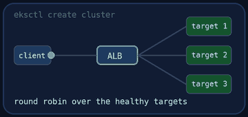
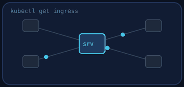
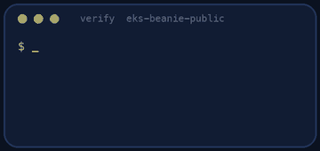
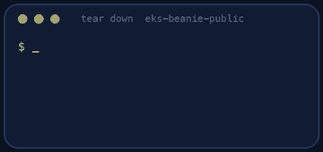

<p align="center"></p>

| | |
|-|-|
| **Time** | 150-180 min |
| **Cost** | about 1 to 2 US dollars if you finish and tear down the same day (control plane $0.10/hour, two nodes, one load balancer) |
| **You need** | An AWS administrator user, the AWS CLI v2, eksctl, kubectl, helm, Docker, git, curl and a terminal |

## How this lab works

1. **Fork** this repository to your own GitHub account (button at the top right).
2. Clone **your fork** in your Ubuntu environment (WSL on Windows, your OrbStack machine on Mac).
3. Read the lab below (the same text is in [`LAB.md`](LAB.md)) and follow the mission.
4. Answer the questions in [`SUBMISSION.md`](SUBMISSION.md). Where a question asks for output, paste it in a code block. No screenshots needed.
5. Commit and push. Open the **Actions** tab of your fork (click *I understand my workflows, go ahead and enable them* the first time). The **Lab check** shows what is still missing.
6. When the check is green, **submit the URL of your fork** in the course platform.

> [!NOTE]
> The check only looks at your answers and any files the lab asks you to commit. Your instructor reads your work and may ask you to explain any line.

<p align="center"></p>

## 🎬 The situation

<p align="center"></p>

```text
PRICE LIST - Beanie on Amazon EKS
EKS control plane      about $0.10 per hour, whether or not anything runs on it
Worker nodes           by the hour
Load balancer          by the hour
Everything above       REAL and BILLABLE, from the first minute
```

Beanie runs beautifully on your laptop. The cafe owner wants to show it to the first customers on Monday, and "on my laptop" is not an address. You will put it on **Amazon EKS**, AWS's managed Kubernetes, behind a real load balancer.

Read the price list twice, because the second thing that makes this lab different is that **deleting it is harder than creating it**. A Kubernetes Service or Ingress creates an AWS load balancer that Kubernetes owns. Delete the cluster before the controller that created it and the load balancer survives, keeps billing and blocks the deletion of the VPC. The order of teardown is part of the lesson, and part of the grade.

> [!IMPORTANT]
> **Your mission**
> - Define the cluster in a file (`cluster.yaml`) and create it with `eksctl`, without a NAT gateway
> - Create an ECR repository, build the image for the right CPU architecture and push it
> - Deploy Beanie with `kustomize`, changing the image in one place
> - Install the NGINX ingress controller with Helm and publish **only the public API** through an Ingress
> - Place an order from the internet, then tear everything down in the right order and prove it

**Time:** 150-180 min (cluster creation alone is 15 min, deletion 10-15) | **Cost:** about 1 to 2 US dollars if you finish and tear down the same day | **You need:** an AWS administrator user, the AWS CLI v2, `eksctl`, `kubectl`, `helm`, Docker, git, curl and a terminal. Everything uses `us-east-1`.

<p align="center"></p>

## Part 0 - Prepare

Fork this repository, clone your fork and run:

```bash
./setup.sh
```

It checks your tools and AWS login, clones Beanie into `beanie/` and prints the names to use (cluster `beanie-eks`, ECR repository `beanie-eks`). **It creates nothing in AWS.** Read `Dockerfile` (it is the same image as in the Kubernetes labs) and the manifests in `k8s/base/`: they are complete and have no ingress; the image is just called `beanie`.

> [!NOTE]
> **Think** The cost clock starts in Part 1. Write down the time now. At the end of the lab, compare it with the time you finish teardown.

<p align="center"></p>

## Part 1 - The cluster, as a file

<p align="center"></p>

Write `cluster.yaml` (the comments in the file say what it must contain), then check it before you spend money:

```bash
eksctl create cluster -f cluster.yaml --dry-run
```

Two lines decide most of the bill: the **node group** and the **NAT gateway**. By default `eksctl` builds a VPC with private subnets and a NAT gateway so that nodes have no public address. A NAT gateway costs about 4.5 cents an hour plus data, as much as a node. For this lab you disable it and let the nodes live in public subnets (they still sit behind security groups). In production you would keep the NAT and the private subnets.

When the dry run looks right:

```bash
eksctl create cluster -f cluster.yaml
```

This takes about 15 minutes. While it runs, open the CloudFormation console: `eksctl` creates **two stacks**, one for the cluster and its network and one for the node group. Read the resources in them.

```bash
kubectl get nodes -o wide
kubectl get pods -A
```

> [!NOTE]
> **Think** Who runs the Kubernetes control plane (API server, etcd, scheduler)? Where in your account does it appear? Who patches the operating system on the nodes?

<p align="center"></p>

## Part 2 - The image, in ECR

The nodes cannot pull an image from your laptop. Create a private repository with scanning on push, tag it `lab=eks-beanie-public`, and push the image.

```bash
aws ecr create-repository --repository-name beanie-eks --image-scanning-configuration scanOnPush=true \
  --tags Key=lab,Value=eks-beanie-public
aws ecr get-login-password --region us-east-1 | docker login --username AWS --password-stdin <account>.dkr.ecr.us-east-1.amazonaws.com
docker build --platform linux/amd64 -t beanie:0.1.0 .
docker tag beanie:0.1.0 <account>.dkr.ecr.us-east-1.amazonaws.com/beanie-eks:0.1.0
docker push <account>.dkr.ecr.us-east-1.amazonaws.com/beanie-eks:0.1.0
```

The `--platform linux/amd64` matters: on an Apple-silicon Mac Docker builds an arm64 image by default, the x86 nodes pull it happily and the container dies with `exec format error`.

> [!NOTE]
> **Predict** The nodes pull from ECR without any password in your manifests. Where does their permission come from? (Look at the IAM role `eksctl` attached to the node group.)

<p align="center"></p>

## Part 3 - Deploy with kustomize

Write `k8s/kustomization.yaml` (see its comments). Before you apply anything, **look at what you are about to apply**:

```bash
kubectl kustomize k8s/ | grep image:
```

Every image line must show your ECR address. Then apply and wait:

```bash
kubectl apply -k k8s/
kubectl get pods -n beanie -w
```

`ingress.yaml` will fail to apply until the controller exists (Part 4). Order matters; read the error.

<p align="center"></p>

## Part 4 - One front door

You do not want five load balancers (one per service) and you do not want the pods on the internet. You want **one** load balancer in front of an **ingress controller**, and a rule that says which paths go where.

```bash
helm repo add ingress-nginx https://kubernetes.github.io/ingress-nginx
helm repo update
helm install ingress-nginx ingress-nginx/ingress-nginx -n ingress-nginx --create-namespace \
  --set controller.service.annotations."service\.beta\.kubernetes\.io/aws-load-balancer-type"=nlb
kubectl get svc -n ingress-nginx -w
```

After a minute the controller's Service gets an `EXTERNAL-IP` that is a long AWS DNS name. That is a **Network Load Balancer** that Kubernetes asked AWS to create. Find it in the EC2 console (Load Balancers) and look at its tags.

Now write `k8s/ingress.yaml`: class `nginx`, **path `/api` only**, to the Service `gateway` on port 8000. Do not route `/`: the gateway also serves `/metrics`, `/docs` and `/chaos`, and none of them belongs on the internet.

```bash
kubectl apply -k k8s/
curl -i http://<load balancer name>/api/menu
curl -i http://<load balancer name>/metrics
```

Menu: 200. Metrics: 404 from NGINX. DNS and the load balancer's health checks need two or three minutes; be patient before you debug.

> [!NOTE]
> **Think** Count every hop between your terminal and a gateway pod: DNS, the NLB, a node, the NGINX pod, the Service, the pod. Which of them did AWS create, which did Kubernetes configure, which did you write?

<p align="center"></p>

## Part 5 - Prove it

<p align="center"></p>

Place an order from the internet:

```bash
curl -s -X POST http://<load balancer name>/api/orders -H 'Content-Type: application/json' \
  -d '{"customer": "Ana", "items": [{"item_id": "flat-white", "quantity": 2}]}'
```

Then run the checker:

```bash
./verify.sh
```

It reads the cluster, node group, VPC, ECR repository, Deployments, Ingress and load balancer from AWS and Kubernetes (it builds its own kubeconfig), and uses the public URL. Fix what is red and run it again until it ends with **ALL CHECKS PASSED**. **Paste the output into `SUBMISSION.md` before you tear down**: after teardown nothing can be verified.

> [!TIP]
> **Stuck?** `exec format error` in a pod: arm64 image (rebuild with `--platform linux/amd64`). `ImagePullBackOff` with `no basic auth credentials`: wrong account or region in the image name. Nodes `NotReady` for minutes: wait, or check the node group stack events. Ingress rejected with `no endpoints available for service "ingress-nginx-controller-admission"`: the controller is not ready yet. The load balancer name does not resolve: wait; the NLB takes 2 to 3 minutes. `curl` hangs: the target group has no healthy targets yet (EC2 console > Target Groups).

<p align="center"></p>

## Part 6 - Take it all down, in order

```bash
./teardown.sh
./verify-teardown.sh
```

`teardown.sh` does it in the order that works: remove the ingress controller (its load balancer disappears), delete the namespaces (volumes), wait until no load balancer of the cluster is left, run `eksctl delete cluster` (node group, cluster, VPC, stacks), then delete the ECR repository. It takes 10 to 15 minutes.

> [!NOTE]
> **Think** What would have happened if you had run `eksctl delete cluster` first? (Try to answer, then look up what stops CloudFormation from deleting a VPC that still contains a load balancer's network interfaces.)

<p align="center"></p>

## Level up (optional)

- Add an `OIDC` provider (`iam.withOIDC: true`) and read about IRSA: how would a pod get AWS permissions without keys on the node?
- Install the AWS Load Balancer Controller and replace NGINX with an ALB-backed Ingress. What do you gain (WAF, ACM certificates) and what do you pay for (one ALB per Ingress group)?
- Add TLS: request an ACM certificate (or use cert-manager) and serve HTTPS.
- Install the EBS CSI driver add-on and run the PostgreSQL StatefulSet from the previous lab on gp3 volumes. Why do volumes appear in `verify-teardown.sh`?

<!-- teardown:start (generated by labs.py, do not edit) -->
## Tear down (mandatory)

<p align="center"></p>

Resources left behind cost money, keep doors open and pollute the next lab. Removing what you created is part of the job, so it is part of the submission: **you must prove it is gone**.

Do this **last**, after you have pasted your `verify` output into `SUBMISSION.md` (once you tear down, the lab can no longer be verified).

1. Run `./teardown.sh`. It removes the ingress controller first (so its load balancer goes), then runs `eksctl delete cluster`, then deletes the ECR repository. It takes 10 to 15 minutes. Do not close the terminal before it finishes.

Then run the proof:

```bash
./verify-teardown.sh
```

It prints a list of checks and must end with **TEARDOWN VERIFIED**. If it reports leftovers, remove them and run it again. Paste the full output in your submission.
<!-- teardown:end -->

<!-- submission:start (generated by labs.py, do not edit) -->
## 📬 Submission

Answer the questions in `SUBMISSION.md` in **your fork** (paste output in code blocks where asked), push, then submit the **URL of your fork**.

**Files to commit**

- `cluster.yaml`: your eksctl cluster definition
- `k8s/kustomization.yaml` and `k8s/ingress.yaml`
- `notes.md` with your commands and what you saw (optional)

**Questions to answer**

1. Paste your `cluster.yaml`. Which two decisions in it cost money, and why did you disable the NAT gateway (and what do you give up by putting the nodes in public subnets)?
2. What did `eksctl create cluster` build for you? List the CloudFormation stacks it created and the AWS resources inside the first one. Who runs the control plane, and who patches the nodes?
3. Paste `docker push` output or `aws ecr describe-images`. How do the nodes get permission to pull from ECR, and what would break if the repository were in another account?
4. Paste `kubectl kustomize k8s/`. Why use `images:` in kustomize instead of editing the image name in five files?
5. Paste `kubectl get ingress,svc -n ingress-nginx` and `curl -i http://<load balancer>/api/menu`. Count the hops from the internet to a gateway pod, and say which of them is a real AWS load balancer.
6. Why is the `gateway` Service of type ClusterIP while the ingress controller has a LoadBalancer? What does it cost to give every service its own load balancer?
7. Teardown order matters: what happens if you delete the cluster before the ingress controller? Paste the output of `./verify-teardown.sh`.
8. Paste the output of `./verify.sh`. It must end with **ALL CHECKS PASSED**.
9. **Tear down.** Paste the output of `./verify-teardown.sh`. It must end with **TEARDOWN VERIFIED**.
<!-- submission:end -->
